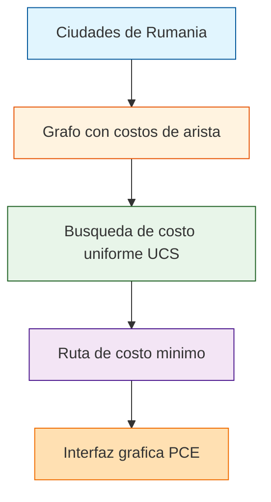

# Problema de las Ciudades con GUI

<p align="center">
  <a href="https://github.com/Matthew-Garay/CiudadesGUI/actions/workflows/ci.yml"></a>
  <a href="https://github.com/Matthew-Garay/CiudadesGUI/security/dependabot"></a>
</p>

El clasico problema de las rutas entre ciudades de Rumania resuelto con busqueda de costo uniforme (UCS) y presentado con una ventana grafica construida con la librería PCE de SWI-Prolog.

## Stack tecnologico

- **Lenguaje:** SWI-Prolog
- **Paradigma:** Programacion logica, busqueda informada, interfaz grafica
- **Entorno:** SWI-Prolog 8.x con libreria PCE

## Arquitectura



## Caracteristicas

- Rutas entre ciudades de Rumania con costos asociados
- Busqueda de costo uniforme (UCS) para camino optimo
- Interfaz grafica con la libreria PCE de SWI-Prolog
- Primera llegada al destino es siempre el camino mas corto

## Como ejecutar

### Requisitos previos

- SWI-Prolog 8.x con la libreria PCE instalada

### Ejecucion

1. Clona el repositorio:
   ```bash
   git clone https://github.com/Matthew-Garay/CiudadesGUI.git
   cd CiudadesGUI
   ```
2. Ejecuta el archivo principal con SWI-Prolog:
   ```bash
   swipl -s ciudadesGUI.pl -g "main" -t "halt"
   ```
3. Se abre una ventana grafica mostrando las rutas entre ciudades.

## Estructura del proyecto

```
CiudadesGUI/
├── ciudadesGUI.pl           # Codigo fuente en Prolog
├── .gitignore               # Archivos excluidos del control de versiones
├── LICENSE                  # Licencia MIT
├── README.md                # Este archivo
└── docs/                    # Documentacion extendida
    ├── setup-guide.md       # Guia de instalacion
    └── architecture.md      # Diagrama de arquitectura
```

## Contacto

<p align="center">
  <a href="mailto:1911.garay.perez@gmail.com"></a>
  <a href="https://www.linkedin.com/in/matthewgarayperez/"></a>
</p>
